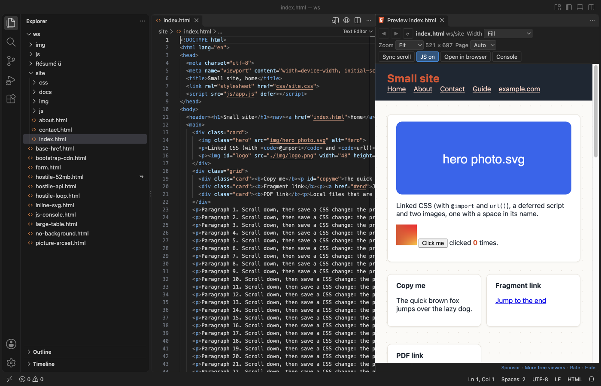
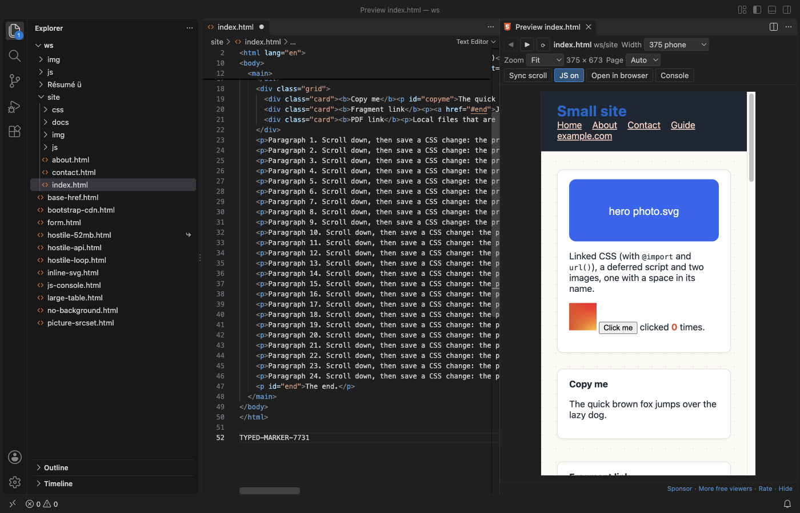
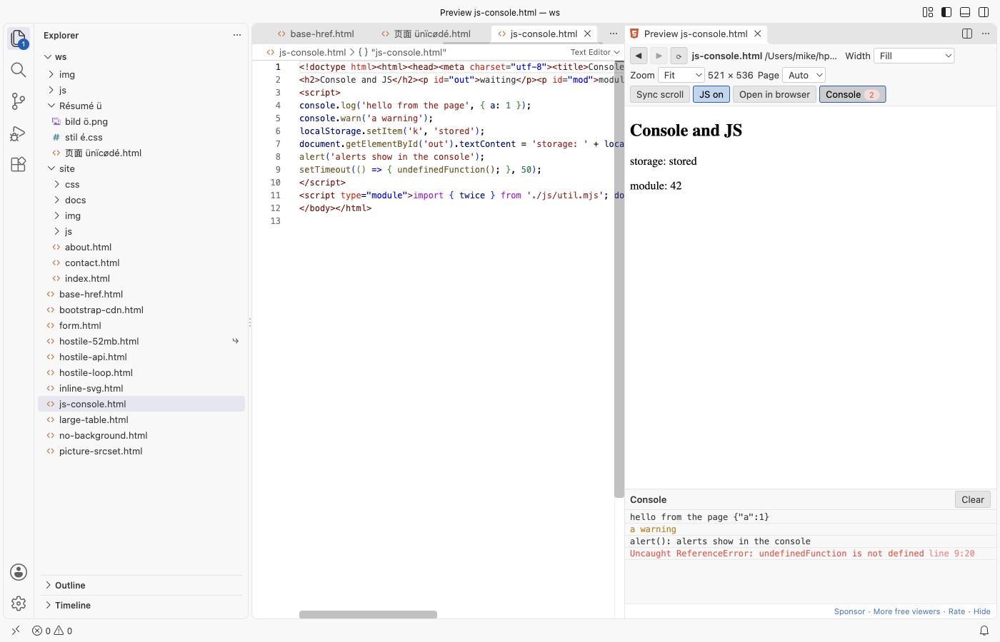
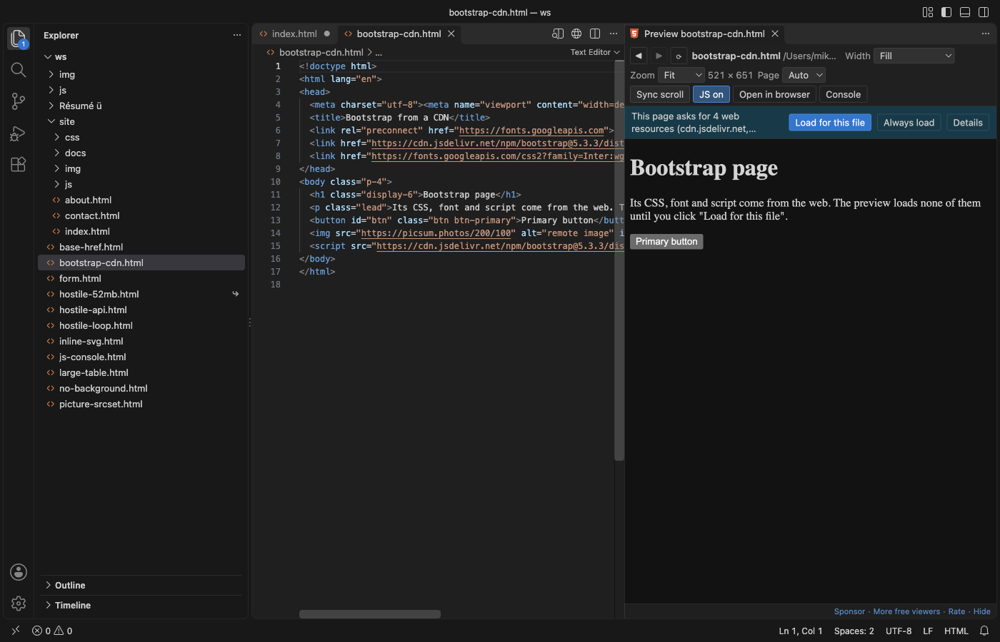
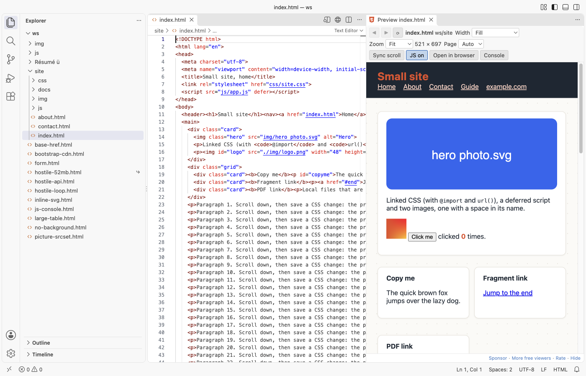

# HTML Preview & HTML Viewer (Live, CSS and Images, Offline)

See your HTML page beside its code in VS Code, with its CSS, JavaScript and images. Free, no sign-in, works offline. It sends nothing anywhere and loads nothing from the web unless you click "Load for this file".

*A real 3-file site (`samples/site/index.html`, its CSS with `@import` and `url()`, a script and two images) in VS Code 1.142, dark theme.*

## Open it

Open an `.html` file and click the preview icon at the top right of the editor, or press `Cmd+K V` (`Ctrl+K V` on Windows and Linux). The preview opens to the side. Your `.html` file stays a normal text editor: this extension never takes it over, and it does not use `Ctrl+Shift+V`.

## Why another HTML preview

The two most installed "HTML Preview" extensions were last updated in 2018. Their reviews and issues name the same problems again and again. This one fixes them:

1. CSS and images show. Linked stylesheets, `@import`, CSS `url()`, scripts, `srcset`, `<picture>`, fonts, video and local iframes all load, from relative paths, `../` paths, `/` paths (the workspace folder is the site root), paths with spaces and names in any language. `<base href>` is followed.
2. It updates as you type. The preview follows the editor, without saving. Save a linked CSS, JS or image file and the preview updates within a moment, even when you did not touch the HTML. The scroll position stays where it was.
3. It works, and it is safe. No local web server and no port. The page runs in a sandboxed frame that cannot reach VS Code, your other files or the network. A page stuck in an endless loop is stopped after 5 seconds, and VS Code stays responsive.

It is also on Open VSX, so it works in Cursor, Windsurf, VSCodium and other editors based on VS Code. It reads files through VS Code, so it works over Remote-SSH, WSL and in dev containers too.

## Features

- Phone, tablet and desktop widths: The Width list sets 320, 375, 768, 1024 or 1440 px, or your own width. Zoom fits the page in the panel or sets 50% to 200%.

  

- Links: links to other local pages open in the preview, with Back and Forward buttons. `#anchor` links scroll the page. Web and mail links ask first, then open in your browser. Other local files (PDF, images, text) open in VS Code.
- Copy: Select text in the preview and press `Cmd+C` (`Ctrl+C`).
- Console: The Console button shows `console.log`, warnings, script errors, unhandled promise rejections, `alert()` text, form submits and the linked files that were not found. A badge counts warnings and errors.

  

- Web resources stay off until you say so: When a page links CSS, fonts, scripts or images from a CDN, a bar shows how many and from which hosts, and nothing is loaded. "Load for this file" loads them for that page; "Always load" turns on `htmlPreview.loadRemoteResources`.

  

- Dark and light: the toolbar follows your VS Code theme. For pages that set no background of their own, Page: Auto shows them in the theme's colors; Light shows them white, as a browser does. Pages with their own background always show it.

  
- JavaScript on or off: Scripts run by default, sandboxed. JS off shows the page as it looks without scripts. In Restricted Mode (an untrusted folder), scripts do not run.
- Scroll sync: Turn on Sync scroll to move the preview with the editor.
- Follows the editor: Switch to another HTML file and the open preview shows it (setting `htmlPreview.followActiveEditor`).
- Open in browser opens the file in your web browser when you want the real thing.

## Large files

HTML files up to 10 MB open at once; a 1.7 MB table with 10,000 rows shows in about a second. Larger files show a message first and are not read until you click "Show anyway" (setting `htmlPreview.maxFileMB`). Files over 32 MB are never shown. Linked files over 25 MB (a big video, for example) are left out and named in the console (setting `htmlPreview.maxResourceMB`).

## Privacy and safety

- No telemetry, no account, no network requests. The preview has a Content Security Policy that blocks every host on the web until you click "Load for this file", and even then only images, styles, fonts, scripts, media and frames may load. `fetch`, XHR and WebSocket stay blocked.
- The page runs in a sandboxed frame with no origin. It cannot call VS Code commands, read the preview toolbar, open popups, send the window to another page or change your clipboard on its own. A page that tries to leave (`location.href = ...`, `<meta http-equiv="refresh">`) stays on your file and is shown without scripts.
- Only files in your workspace folders, the page's folder and the folder above it are read. A page asking for `file:///etc/passwd` gets nothing, and the console says why.
- `localStorage`, `sessionStorage` and `document.cookie` work in memory for the page and are gone when the preview updates.

## Settings

| Setting | Default | What it does |
|---|---|---|
| `htmlPreview.followActiveEditor` | `true` | The preview shows the HTML file you switch to |
| `htmlPreview.updateDelayMs` | `300` | Wait after typing before the preview updates |
| `htmlPreview.runScripts` | `true` | Run the page's JavaScript (sandboxed) |
| `htmlPreview.loadRemoteResources` | `false` | Load CSS, fonts, scripts and images from the web in every page |
| `htmlPreview.pageBackground` | `auto` | Colors for pages that set none: `auto`, `light` or `dark` |
| `htmlPreview.scrollSync` | `false` | Scroll the preview with the editor |
| `htmlPreview.maxFileMB` | `10` | Larger HTML files wait for "Show anyway" |
| `htmlPreview.maxResourceMB` | `25` | Larger linked files are left out |
| `htmlPreview.stuckScriptSeconds` | `5` | Stop page scripts that keep the preview busy this long |
| `htmlPreview.askForRating` | `true` | Ask for a rating once you have used it on a few days |
| `htmlPreview.showSupportLinks` | `true` | Show the small Sponsor and More free viewers links |

## Limits

- It is a preview, not a web server. Pages that need one (`fetch` of local JSON files, server-side includes, PHP) do not work here; use a local server for those.
- ES module imports are followed when they are relative (`./x.js`). Bare imports (`import "react"`) and import maps are not.
- Dialogs (`alert`, `confirm`, `prompt`) do not open in VS Code; they are written to the console, and `confirm` answers Cancel.
- Edits made in the preview are not saved back to the file.

## Support Zovo

Zovo extensions are free, with no ads and no tracking. They are made by [theluckystrike](https://github.com/theluckystrike) on GitHub. If this one saves you time, you can support the work:

- [Sponsor on GitHub](https://github.com/sponsors/theluckystrike)
- [Follow theluckystrike on GitHub](https://github.com/theluckystrike)

## More tools by Zovo

- [HAR Viewer & HAR File Analyzer](https://marketplace.visualstudio.com/items?itemName=zovo.zovo-har-viewer) opens HAR files from browser DevTools with a timing waterfall, filters and a redacted copy for sharing.
- [Large JSON Viewer, JSON Browser & JSON Tree](https://marketplace.visualstudio.com/items?itemName=zovo.zovo-json-tree-viewer) shows large JSON files as a searchable tree, copies JSONPath and turns arrays of objects into a table.
- [Mermaid Viewer & Mermaid Preview](https://marketplace.visualstudio.com/items?itemName=zovo.mermaid-viewer) previews .mmd files and mermaid blocks in Markdown, with SVG and PNG export.
- [Graphviz Viewer & DOT Viewer](https://marketplace.visualstudio.com/items?itemName=zovo.zovo-graphviz-preview) shows a live preview of DOT files and exports SVG or PNG.
- [PDF Viewer & PDF Reader](https://marketplace.visualstudio.com/items?itemName=zovo.pdf-viewer-dark) reads PDFs with a real dark mode, search, an outline and thumbnails.

See [all Zovo extensions on the Marketplace](https://marketplace.visualstudio.com/publishers/zovo).

## More from zovo

- [All free zovo VS Code extensions](https://marketplace.visualstudio.com/publishers/zovo) — file viewers, database clients, formatters. Offline, no telemetry, no sign-up.
- [Full MCP server catalogue](https://theluckystrike.github.io/mcp/) — local-first MCP servers for back-office work: invoices, VAT, PDFs, spreadsheets, payroll.
- [Hosted no-install MCP endpoints](https://mcp.zovo.one) — paste a URL in Claude / Cursor, nothing to install.
